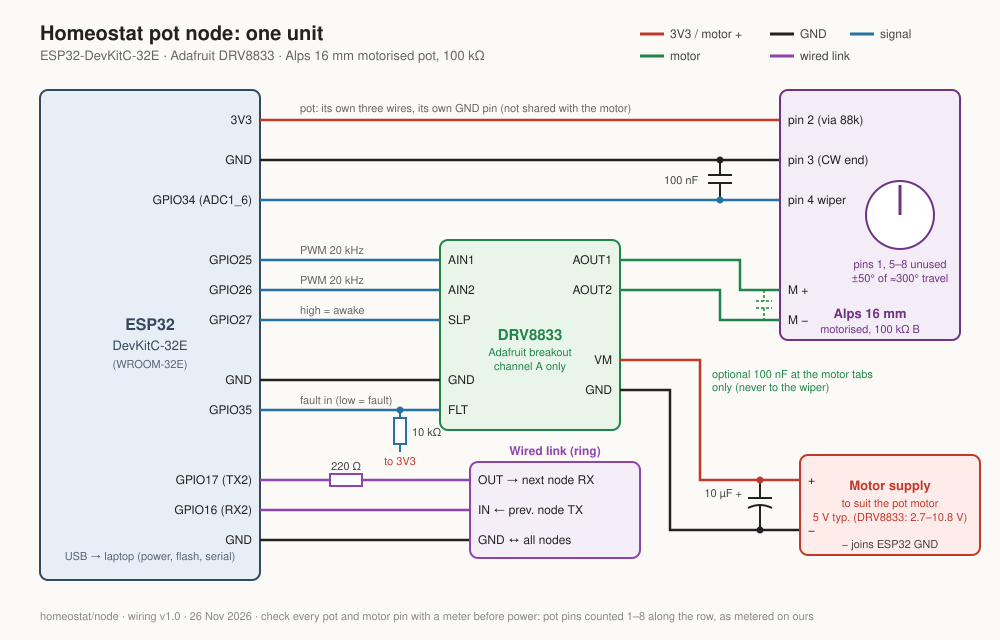
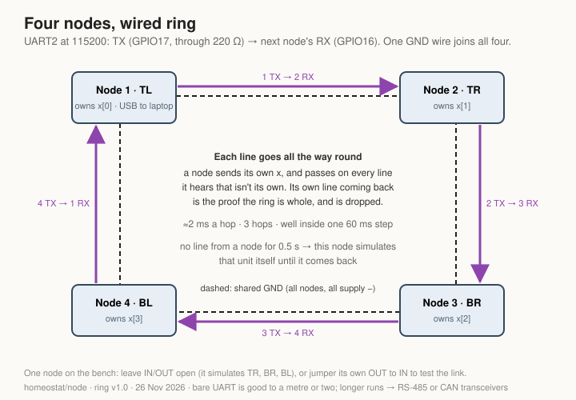

# Homeostat pot node

One unit of the four-unit homeostat as an object you can hold. An ESP32 runs the unit's own equation
(what TL is in the browser sim), a motorised rotary pot is its needle, and the same pot is how a hand
gets in: the motor turns the knob to follow the unit's state, and when a hand takes the knob the motor
lets go and the hand becomes the needle. Let go and the unit carries on from where the hand left it.

It follows on from the [TL fader](../homeostat-arm/fader/HANDOVER.md) (a slide fader played by the
browser sim over USB). The difference: **the model now runs on the node**, so four nodes wired
together are a homeostat with no laptop at all. The [distributed homeostat](../distributed/README.md)
does the same over ESP-NOW with LEDs for needles; this one starts wired, and with a needle you can
grab.

Framing, kept from the fader: the hand outranks the model. A machine that proposes, a person who can
overrule.

Status: **design, nothing built yet** (26 Nov 2026). Start with one node; it simulates the other three
until real ones join.

## Parts (one node)

| Part | Notes |
|---|---|
| ESP32-DevKitC-32E (WROOM-32E) | classic ESP32, not an S3: pins differ from the fader's SuperMini |
| Alps 16 mm motorised pot, 100 kΩ linear (RK16812MG-class) | 3 pot pins + 2 motor tabs; motor usually 5 V |
| Adafruit DRV8833 breakout | two H-bridges, only channel A used; 2.7–10.8 V motor supply, silent at 20 kHz |
| 100 nF ceramic | wiper to pot GND (the 100 kΩ track is a high-impedance source for the ADC) |
| 10 µF electrolytic + 0.1 µF ceramic | across VM / GND at the driver (stripe to GND) |
| 10 kΩ | FLT pull-up (GPIO35 has no internal pull-up) |
| 220 Ω | in series with TX on the wired link |
| 100 nF ceramic (optional) | across the motor tabs only, if the motor makes the reading noisy |
| Motor supply | to suit the pot motor (assumed sorted) |

## Wiring



| From | To | Note |
|---|---|---|
| Pot **pin 2** / **pin 3** / **pin 4 (wiper)** | **3V3** / **GND** / **GPIO34** | pot gets **its own three wires** and its own GND pin. Wiper runs 0 → ~1.65 V (see below) |
| 100 nF | wiper ↔ pot GND | right at the pot |
| DRV8833 AIN1 / AIN2 | GPIO25 / GPIO26 | both PWM at 20 kHz |
| DRV8833 SLP | GPIO27 | high = awake; firmware sleeps the driver on a fault |
| DRV8833 FLT | GPIO35 + 10 kΩ to 3V3 | goes low on over-current / over-temperature |
| DRV8833 GND (logic side) | ESP32 GND | |
| DRV8833 AOUT1 / AOUT2 | pot motor + / − | nothing else on these two |
| DRV8833 VM / GND | motor supply + / − | 10 µF + 0.1 µF across them; supply − joins ESP32 GND |
| GPIO17 (TX2) → 220 Ω | next node's RX | wired link OUT |
| GPIO16 (RX2) | previous node's TX | wired link IN |
| GND | every node's GND | one common ground for the link |
| USB | laptop | power, flashing, serial view |

**Pins to stay off** on the classic ESP32: GPIO6–11 (flash) and 0/2/5/12/15 (strapping: GPIO12 pulled
high at boot sets the flash to 1.8 V and the board won't start). **Never read an analog value on ADC2**
(GPIO0/2/4/12–15/25–27): it stops working as soon as the radio is on. Using 25–27 as plain digital/PWM
outputs, as here, is fine. GPIO34–39 are input only with no pull-ups. The pot is on ADC1 (GPIO34) so
that ESP-NOW can be added later without moving it.

**Lessons carried over from the fader** (all of these looked like software and weren't):

- Meter every pin before power. Ours (RK16812MG0AF) has a row of 8 on the body (dual gang) and 2
  motor pins at the back. A generic pinout found online (1 dummy, 2 CCW, 3 wiper, 4 CW) was wrong.
  Metered on ours: **pin 4 is the wiper; pin 3 is the CW end of an ~86 k track; pin 2 reaches the
  CCW end only through ~88 k more** (2 ↔ 3 = 174 k, 2 ↔ 4 = 88 k at hard CCW). Pin 1 is open (our
  meter shows open as "0", which misled us once). 5–8 unused.
- So: **3V3 on pin 2, GND on pin 3.** The wiper then runs 0 V (hard CW) to ~1.65 V (hard CCW), raw
  0 → ~1925, in the ADC's most linear range: ~6.4 counts a degree, ±3 counts of noise (~0.5°).
  The other way round (3V3 on 3, GND on 2) reads only 1.67 → 3.3 V, half of it clipped at 4095.
- A meter "0" that should be a resistance: check what the meter shows with the probes apart.
- The wiper cap is the small 0.1 µF ceramic. A 10 µF there makes the reading lag the knob.
- With the board in a breadboard, check nothing sits in the RX/TX (GPIO3/1) rows: it stopped uploads
  ("serial TX path seems to be down") until the board was flashed on USB alone.
- The pot's ground must not carry motor current. Its own wire to its own ESP32 GND pin.
- No capacitor between a motor output and the wiper.
- Motor on its own supply, never the ESP32's USB 5 V (brownout resets mid-move).

## The knob: 100° of travel

The needle uses **100°** of the pot's ≈300°: Ashby's ±45° viable range, plus 5° each side.

```
      −50°  −45°            0°            +45°  +50°
        |·····|─────────────┼─────────────|·····|
      margin  └──── viable (no S2) ───────┘  margin
```

- −45…+45°: the unit's state, as on the sim's dial.
- Past ±45°: the unit is out of its viable range and its uniselector (S2) fires, as in the sim.
- ±50°: hard limit. The motor never drives past it; a reading beyond it is clamped.
- **Calibrated on node 1** (26 Nov, `node_v1_4`+): knob rested on marks drawn on the faceplate, 2 s
  each, ±2 counts: **−50° = 1779, 0° = 1519, +50° = 1229.** The halves differ (260 vs 290 counts:
  the ADC's slight bend plus hand-drawn marks), so degrees are two straight lines meeting at 0 and
  every mark is exact. About 5.5 counts a degree; noise ±2 counts, under 0.5°. Set live with
  `lo` / `zero` / `hi` (or `lo N` …), then copy into the sketch.
- **Speed is the motor's, not ours:** about **28°/s** at full power, matching the datasheet (300° in
  12 ± 3 s). A full −50° → +50° swing takes ~4.5 s; holds land within ~0.5–0.8° with no overshoot
  (`node_v1_6`: KP 4, deadband 6 counts). The homeostat on this node will need a needle that moves at
  this pace (or a unit that runs slower than the browser sim's TL).
- The middle third of the ESP32's ADC range is its most linear part (it bends near 0 V and above
  ≈2.6 V), so using only 100° helps here too.
- Worth a physical stop on the faceplate at ±50° (a pin in the knob's path) so a hand can't wind it
  past the window.

## What the firmware does

Planned as bench sketches first (`bench/node_v1_0` … wiring checks, jog/hold, live tuning, as the fader
went), then `homeostat_node/homeostat_node.ino`.

- **The unit:** integrates its own x every 60 ms (`DT 0.06`), from its own row of the coupling matrix
  and the latest x of the other three. Out of range (`|x|` past ±45°) → S2 randomises its row. No
  reset of x on S2: the system heals by changing its relations, not by erasing the disturbance
  (`distributed/` notes).
- **The needle:** the motor follows x on the knob (PD, aim ahead, rate limit; tuning starts from the
  fader's values). DRV8833 at 20 kHz should remove the fader's 500 Hz hum and its 2 V loss.
- **The hand:** knob more than ~4° from where the motor is taking it, and not coming back → `held`:
  motor off, x = knob. Released after the knob is still for a while. Judged by displacement, as on the
  fader (no touch track).
- **Modes:** `rest`, `follow`, `held`, `fault` (stuck reading, pushing without moving, or DRV8833 FLT
  low → motor off 3 s, SLP low, retry).
- **Alone:** a unit with no line from its node for 0.5 s is simulated locally, so one node on the
  bench is a whole homeostat with one physical needle. When a real node appears, its unit is handed
  over.

### Wired link: a ring



Each node's TX goes to the next node's RX, round the four, with one shared GND. No transceivers, no
collisions, no bus arbitration: just UART2 at 115200 and the resistors already in the parts list.

- Every 60 ms a node sends one line: `X <id> <seq> <x>` (e.g. `X 1 4821 -12.40`).
- It passes on every line it hears from another node, unchanged. Its own line coming back after three
  hops (≈2 ms each) is dropped, and is also the sign that the ring is whole.
- A ring break loses some nodes for some others; each node falls back to simulating whoever it can't
  hear. Nothing stops.
- Bare 3.3 V UART is fine across a table, a metre or two. For room-scale runs: RS-485 (MAX485 /
  SP3485) on the same pins, or CAN (the ESP32's TWAI + SN65HVD230), or ESP-NOW, which the
  `distributed/` nodes already speak.

### USB serial (to the laptop)

Kept close to the fader's protocol so `arm/fader.py` and the sim page can learn to talk to a node:

- Out: `{"version":…}` as the first line at boot, then `{"id","deg","pos","tgt","mode","x":[…4]}`
  every 40 ms, and human lines (`hand on`, `S2 fired`, `FAULT: …`).
- In: `V` (version), live tuning (`kp kd min max speed smooth <n>`), `jog`, `hold`, raw readings for
  bring-up.

### Versions

As everywhere in this repo: a `flash.ps1` (copied from the fader's) writes `version.h` from git
(`commit · dd Mon HH:mm [+N uncommitted]`). The node prints it as its first serial line, and sends it
once on the ring at boot so every node can report what the others are running. Commit before the final
flash.

## Bring-up order (one node)

1. ESP32 alone on USB: flash, see the version line.
2. Pot wiper on GPIO34, motor unpowered: turn by hand, watch raw counts move smoothly 0…4095. Mark the
   ±50° window, set `POS_LOW` / `POS_HIGH`.
3. DRV8833 with motor supply: `jog` each way at low duty. If it drives away from the target, swap
   AOUT1/AOUT2 (or flip `motorReversed`), not the code's sign.
4. `hold` at a few angles; push it by hand and see `hand on` / `held`.
5. The unit running alone (three simulated neighbours), needle following, hand taking over.
6. Jumper OUT to IN: the node should hear its own line come back.
7. Second node, two-node ring (OUT→IN both ways), then four.

## Open questions

- Motor voltage and stall current of this exact pot (sets the supply and `MAX_DUTY`).
- Does this part have a touch-sense terminal? If so, touch is a cleaner hand signal than displacement
  (ESP32 `touchRead` on a touch-capable pin, e.g. GPIO32/33).
- Whether the laptop sim should be able to join the ring as a fifth listener (via node 1's USB) to show
  all four needles on the page.
